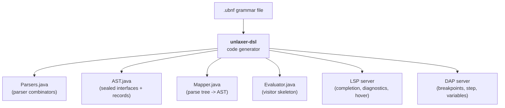
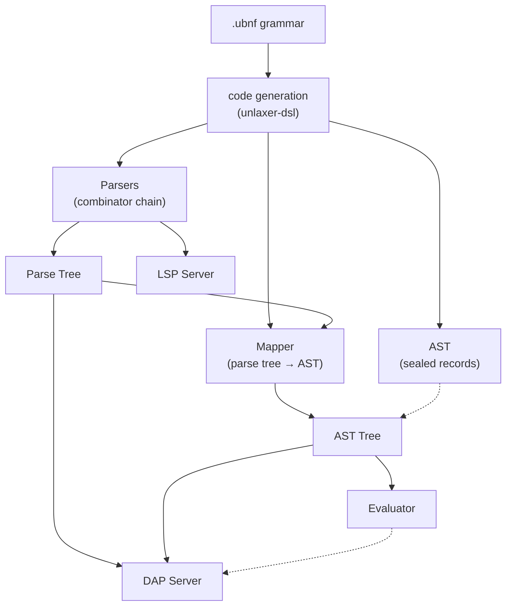

[English](./README.md) | [日本語](./README-ja.md)

---

```
                _
  _   _ _ __   | | __ ___  _____ _ __
 | | | | '_ \  | |/ _` \ \/ / _ \ '__|
 | |_| | | | | | | (_| |>  <  __/ |
  \__,_|_| |_| |_|\__,_/_/\_\___|_|
                              - parser
```

# unlaxer-parser

**3.3.0 is published** on [Maven Central](https://repo1.maven.org/maven2/org/unlaxer/unlaxer-parser/3.3.0/unlaxer-parser-3.3.0.pom) and [GitHub Releases](https://github.com/opaopa6969/unlaxer-parser/releases/tag/v3.3.0). See the [verified source, signatures, and consumer results](release/3.3.0-verification.json).
The development UBNF VSIX includes an in-editor [beginner catalog/help](unlaxer-dsl/ubnf-vscode/README.md).
Generate a self-contained [language playground from UBNF](docs/ubnf-playground-ja.md), including UBNF's own meta-grammar.
Try UBNF grammar syntax, AST and CST in the [online UBNF playground](https://opaopa6969.github.io/unlaxer-parser/ubnf/).

**Java / Rust support.** Includes a native Rust UBNF generator, runtime, and LSP / DAP. See [support and production readiness](#java--rust-support-and-quality).

**Write a grammar, get a language — Parser + AST + Evaluator + LSP + DAP, all generated**

[](https://central.sonatype.com/artifact/org.unlaxer/unlaxer-common)
[](./LICENSE)
[]()
[]()

---

> **Latest release — 3.3.0**: Unicode 17 grapheme parsing and typed coordinates, source-preserving language composition, semantic queries, selectable token streams, and Java/Rust IDE support. Includes recursion limits and source-position/protocol fixes verified against shared corpora. See the [quality criteria](./docs/production-quality.md), [grapheme API](./docs/grapheme-coordinates.md), and [CHANGELOG](./CHANGELOG.md) for scope and compatibility notes. Java 21 and Java 17 artifacts remain separate. Historical note: **3.0.2 was never published to Maven Central**. For migrations from `2.x`, also see the [downstream drift warning](#downstream-drift-warning).

---

## Table of Contents

- [The Problem](#the-problem)
- [The Solution](#the-solution)
- [Quick Example](#quick-example)
- [What Gets Generated](#what-gets-generated)
- [Java / Rust Support and Quality](#java--rust-support-and-quality)
- [5-Minute Quick Start](#5-minute-quick-start)
- [Architecture](#architecture)
- [Bootstrap and Self-Hosting](#bootstrap-and-self-hosting)
- [Real-World Example](#real-world-example)
- [Downstream Drift Warning](#downstream-drift-warning)
- [API Deprecation Policy](#api-deprecation-policy)
- [Documentation](#documentation)
- [Why unlaxer?](#why-unlaxer)
- [Project Structure](#project-structure)
- [foundation-poisonpills Note](#foundation-poisonpills-note)
- [License](#license)

---

## The Problem

Building a DSL typically means writing and maintaining **6+ subsystems** by hand:

| Subsystem | Lines (approx.) |
|-----------|----------------|
| Lexer / Parser | 2,000+ |
| AST node types | 1,500+ |
| Parse-tree-to-AST mapper | 1,000+ |
| Evaluator / interpreter | 2,000+ |
| LSP server (completion, diagnostics, hover) | 2,500+ |
| DAP server (breakpoints, stepping, variables) | 1,500+ |
| **Total** | **10,000+** |

These subsystems are tightly coupled. A single grammar change cascades across all of them.

## The Solution

Write a **UBNF grammar** (~300 lines). Run the generator. Get everything.



Implement evaluation in the `evalXxx` methods. Typed completion, external-language integration, and runtime debugging also need application providers or hooks. The generation examples below target Java.

---

## Quick Example

Here is a fragment from the [tinyexpression](https://github.com/opaopa6969/tinyexpression) UBNF grammar:

```ubnf
@mapping(BinaryExpr, params=[left, op, right])
@leftAssoc
@precedence(level=1)
NumberExpression ::= NumberTerm @left { AddOp @op NumberTerm @right } ;

@mapping(BinaryExpr, params=[left, op, right])
@leftAssoc
@precedence(level=2)
NumberTerm ::= NumberFactor @left { MulOp @op NumberFactor @right } ;

AddOp ::= '+' | '-' ;
MulOp ::= '*' | '/' ;
```

From this, unlaxer generates:

- A **parser** that handles operator precedence and left-associativity correctly
- A **`BinaryExpr` AST record** with typed `left`, `op`, `right` fields
- A **mapper** that preserves a scalar `left` and ordered `op` / `right` lists; the evaluator folds these lists from the left
- An **`evalBinaryExpr`** hook in the evaluator skeleton

---

## What Gets Generated

| You Write | unlaxer Generates |
|-----------|-------------------|
| Grammar rules (`::=`) | Parser combinators (`Parsers.java`) |
| `@mapping` annotations | AST sealed interfaces + records (`AST.java`) |
| `@left`, `@right`, `@op` captures | Parse-tree-to-AST mapper (`Mapper.java`) |
| `@leftAssoc` / `@rightAssoc` | Associativity structure (left fold in user evaluation) |
| `@root` | Entry point parser |
| (your grammar) | Evaluator skeleton with `evalXxx` hooks (`Evaluator.java`) |
| (your grammar) | LSP server (completion, diagnostics, hover) |
| (your grammar) | DAP server (breakpoints, stepping, variables) |

---

## Java / Rust Support and Quality

This repository provides Java and Rust implementations of **unlaxer Classic**, the stateful combinator runtime. The table describes **3.3.0**; these additions are not present in Maven 3.2.0.

| Area | Java | Rust Classic |
|---|---|---|
| UBNF generation | `CodegenMain` / Maven | Native `unlaxer generate`, or Java-hosted `generate --target rust` |
| Generated code | Parser, record AST, mapper, evaluator | Parser, enum AST, mapper, `Semantics` trait; five modules by default |
| Execution | JVM 21, or separate JVM 17 artifacts | Native / WASM; native execution needs no JVM |
| IDE | Generated LSP / DAP and extension hooks | Opt-in `--lsp` / `--dap`: stdio LSP and AST / token inspection |
| Distribution | Stable Maven Central artifacts | Repository path dependencies and Linux x86_64 CI artifacts; crates use `publish = false` |

**Java and Rust share documented [production quality criteria](docs/production-quality.md), covering source positions, Unicode, recursion limits, and IDE lifecycle.** Evaluate production use within the supported scope and resource limits against your grammar, workload, and deployment environment. This does not declare compatibility with every Java grammar or support for unimplemented features. Publication on crates.io and implementation quality are separate questions.

The evidence includes [CI](.github/workflows/maven.yml) on Rust 1.85 with Cargo test / fmt / Clippy, shared Java/Rust acceptance, rejection, AST and source-position corpora, Java-host/native generator agreement, actual stdio LSP/DAP exchanges, and release-binary smoke tests. Plain `mvn test` skips Rust conformance; enable `-DrustConformance=true` to reproduce it. Commands are in the [Rust README](rust/README.md).

The development branch adds [Unicode-pinned `CI('word')` tokens](docs/case-insensitive-tokens.md) to both Java and Rust, removing JDK Unicode-version drift and correcting unsafe Java candidate pruning. This addition is **not included in the published 3.3.0 artifacts**.

The development branch adds [transactional `NonOrdered`](docs/nonordered-runtime.md) to the Rust runtime and fixes failed-candidate state leakage in Java. Each declared child occurrence is selected once, with declaration-order priority; later failure does not explore other permutations. This is not included in 3.3.0.

Java also gains [explicit PEG assertions](docs/peg-assertions.md), matching the state rollback of Rust `ahead()` / `not_ahead()`. Classic match-only remains a separate contract; general consume/invert propagation, replay, and diagnostic-frontier gaps remain tracked in [#545](https://github.com/opaopa6969/unlaxer-parser/issues/545).

The development branch also supports [Classic token-mode propagation](docs/classic-token-propagation.md) through general Rust expressions and custom parsers. The four kinds, inherited inversion, both cursors, and source projection are checked against Java. Capture/replay integration, external code-fence adapters, and observer exceptions remain tracked separately; this runtime slice does not complete parity.

The development branch also adds [full semantic-token providers](docs/classic-rust-lsp.md) to Rust and validates the existing Java hook against the same protocol corpus. Both default to empty data; applications supply the token legend and encoded tokens. Range and delta requests remain unsupported. This is not included in 3.3.0.

See the [full-spec matrix](rust/FULL-SPEC.md) and [IDE inventory](docs/lsp-dap-ide-gap-inventory.md) for remaining limits: Rust incremental parsing, LSP cancellation / rename and formatting transport, and some tokens and annotations are unsupported. DAP implements AST/token stepping, not live evaluator suspension. Numeric capture types/conversion and some diagnostics also differ between Java and Rust; compatibility with every Java grammar is not guaranteed.

Downstream `tinyexpression-rs` and `rustcodeblock` AOT exist on the separate **ubnfc** engine. Their results do not establish Classic Rust parity or production deployment history. See the [engine guide](docs/engine-selection-guide-ja.md) and [pinned downstream audit](rust/FULL-SPEC.md#下流tinyexpressionの現状監査2026-09-30).

---

## 5-Minute Quick Start

### 1. Add Maven dependencies

```xml
<dependencies>
    <dependency>
        <groupId>org.unlaxer</groupId>
        <artifactId>unlaxer-common</artifactId>
        <version>3.3.0</version>
    </dependency>
    <dependency>
        <groupId>org.unlaxer</groupId>
        <artifactId>unlaxer-dsl</artifactId>
        <version>3.3.0</version>
    </dependency>
</dependencies>
```

**Java 17 users** (for example Corretto 17): the artifacts above are built for Java 21
(class file major 65). Depend on the drop-in `-jdk17` builds instead — same groupId, version,
packages and classes, compiled with `--release 17` (major 61):

```xml
<dependency>
    <groupId>org.unlaxer</groupId>
    <artifactId>unlaxer-common-jdk17</artifactId>
    <version>3.3.0</version>
</dependency>
<dependency>
    <groupId>org.unlaxer</groupId>
    <artifactId>unlaxer-dsl-jdk17</artifactId>
    <version>3.3.0</version>
</dependency>
```

`unlaxer-dsl-jdk17` depends on `unlaxer-common-jdk17` only. Use one family, not both. If the
generated Java must also run on Java 17, pass `--java-release 17` to `CodegenMain` (it changes only
the Evaluator dispatch; see [unlaxer-dsl/README.md](unlaxer-dsl/README.md)).

### 2. Write a grammar

Create `src/main/resources/TinyCalc.ubnf`:

```ubnf
grammar TinyCalc {
  @package: com.example.tinycalc
  @whitespace: javaStyle

  token NUMBER = org.unlaxer.parser.elementary.NumberParser
  token EOF    = org.unlaxer.parser.elementary.EndOfSourceParser

  @root
  Formula ::= Expression EOF ;

  @mapping(BinaryExpr, params=[left, op, right])
  @leftAssoc
  @precedence(level=1)
  Expression ::= Term @left { AddOp @op Term @right } ;

  @mapping(BinaryExpr, params=[left, op, right])
  @leftAssoc
  @precedence(level=2)
  Term ::= Factor @left { MulOp @op Factor @right } ;

  Factor ::= Literal | '(' Expression ')' ;

  @mapping(NumberLiteral, params=[value])
  Literal ::= Digits @value ;
  Digits ::= NUMBER ;

  AddOp ::= '+' | '-' ;
  MulOp ::= '*' | '/' ;
}
```

### 3. Add the code generator plugin

```xml
<build>
    <plugins>
        <plugin>
            <groupId>org.codehaus.mojo</groupId>
            <artifactId>exec-maven-plugin</artifactId>
            <version>3.1.0</version>
            <executions>
                <execution>
                    <phase>generate-sources</phase>
                    <goals>
                        <goal>java</goal>
                    </goals>
                    <configuration>
                        <mainClass>org.unlaxer.dsl.CodegenMain</mainClass>
                        <arguments>
                            <argument>--grammar</argument>
                            <argument>${project.basedir}/src/main/resources/TinyCalc.ubnf</argument>
                            <argument>--output</argument>
                            <argument>${project.build.directory}/generated-sources/ubnf</argument>
                            <argument>--generators</argument>
                            <argument>AST,Parser,Mapper,Evaluator</argument>
                        </arguments>
                    </configuration>
                </execution>
            </executions>
        </plugin>
        <plugin>
            <groupId>org.codehaus.mojo</groupId>
            <artifactId>build-helper-maven-plugin</artifactId>
            <version>3.5.0</version>
            <executions>
                <execution>
                    <id>add-generated-sources</id>
                    <phase>generate-sources</phase>
                    <goals>
                        <goal>add-source</goal>
                    </goals>
                    <configuration>
                        <sources>
                            <source>${project.build.directory}/generated-sources/ubnf</source>
                        </sources>
                    </configuration>
                </execution>
            </executions>
        </plugin>
        <plugin>
            <groupId>org.apache.maven.plugins</groupId>
            <artifactId>maven-compiler-plugin</artifactId>
            <version>3.13.0</version>
            <configuration>
                <release>21</release>
            </configuration>
        </plugin>
    </plugins>
</build>
```

Add this under `<project>` in `pom.xml`. Registering the generated source root makes `mvn compile` compile the generated code too. For Java 17, also change the compiler `release` to `17`.

### 4. Generate code

```bash
mvn compile
```

This generates four files under `target/generated-sources/ubnf/com/example/tinycalc/`:

```
TinyCalcParsers.java    -- parser combinators
TinyCalcAST.java        -- sealed interface + records (BinaryExpr, etc.)
TinyCalcMapper.java     -- parse tree -> AST transformation
TinyCalcEvaluator.java  -- abstract evaluator with evalXxx hooks
```

### 5. Write the evaluator

Create `src/main/java/com/example/tinycalc/CalcEvaluator.java`.

```java
package com.example.tinycalc;

import com.example.tinycalc.TinyCalcAST.BinaryExpr;
import com.example.tinycalc.TinyCalcAST.NumberLiteral;

public class CalcEvaluator extends TinyCalcEvaluator<Double> {

    @Override
    protected Double evalBinaryExpr(BinaryExpr node) {
        double result = eval(node.left());
        for (int i = 0; i < node.op().size(); i++) {
            double right = eval(node.right().get(i));
            result = switch (node.op().get(i).strip()) {
                case "+" -> result + right;
                case "-" -> result - right;
                case "*" -> result * right;
                case "/" -> result / right;
                default -> throw new IllegalArgumentException("Unknown op: " + node.op().get(i));
            };
        }
        return result;
    }

    @Override
    protected Double evalNumberLiteral(NumberLiteral node) {
        return Double.parseDouble(node.value());
    }
}
```

### 6. Run it

Call the mapper from a `main` method in the same package.

```java
var ast = TinyCalcMapper.parse("1 + 2 * 3");
var result = new CalcEvaluator().eval(ast);
System.out.println(result);  // 7.0
```

See [docs/getting-started.md](./docs/getting-started.md) for the full walkthrough.

---

## Architecture



See [docs/architecture.md](./docs/architecture.md) for the full pipeline, combinator catalog, and ParserIR design.

---

## Bootstrap and Self-Hosting

The UBNF grammar file `unlaxer-dsl/grammar/ubnf.ubnf` is itself written in UBNF, and unlaxer-dsl can run its own code generator over it. This self-application is **partial today**; here is exactly what is and isn't guaranteed:

- The **live implementation is the hand-written bootstrap** in `org.unlaxer.dsl.bootstrap` (`UBNFParsers`, `UBNFAST`, `UBNFMapper`). Production codegen (`CodegenMain` / `CodegenRunner`) imports these hand-written classes.
- The generator can regenerate a `UBNFParsers` from `ubnf.ubnf`, and the self-hosting tests confirm the generated source compiles and is structurally sound. The generated `UBNFParsers` currently checked in (under `bootstrap/generated/`) is a thin shim that **delegates back to the hand-written parser**; there is **no** generated `UBNFAST` or `UBNFMapper`.
- Because no generated `UBNFMapper` exists yet, the fixpoint tests (`SelfHostingTest`, `SelfHostingRoundTripTest`) reuse the hand-written `UBNFMapper` in both stages. As their own comments note, this is **not a true fixpoint** — what they guarantee is that generation is **deterministic** (stage-1 output == stage-2 output), not that a generated toolchain reproduces itself end to end.

In short: UBNF describing UBNF, plus deterministic self-application of the parser generator, are in place; a fully self-hosted pipeline (generated parser *and* generated mapper regenerating themselves) is not yet complete.

See [docs/architecture.md — Bootstrap](./docs/architecture.md#bootstrap-and-self-hosting) for details.

---

## Real-World Example

**[tinyexpression](https://github.com/opaopa6969/tinyexpression)** is a complete formula language built with unlaxer-parser.

- ~300-line UBNF grammar
- Variables, functions (`sin`, `cos`, `sqrt`, `min`, `max`), ternary operator, if/else, method declarations
- LSP support (completion, diagnostics, hover, go-to-definition)
- DAP support (breakpoints, stepping, variable inspection)
- Used in production

---

## Downstream Drift Warning

> **Warning**: Some of the following downstream projects were originally built against **unlaxer-parser 2.x**. API changes in `UBNFAST`, `UBNFMapper`, and the `CodegenMain` entry point may cause breakage; check each project's last-validated version before upgrading.

| Downstream project | Last validated against | Status |
|--------------------|----------------------|--------|
| [tinyexpression](https://github.com/opaopa6969/tinyexpression) | Current reactor version in CI; historical 3.0.4 | [Downstream CI](.github/workflows/maven.yml) tests a pinned Java downstream against the build under test (`p4-smoke`, mapper and LSP); this does not validate Classic Rust deployment |
| [onigiri-parser](https://github.com/opaopa6969/onigiri-parser) | 3.0.1 | `mvn compile` success ([#27](https://github.com/opaopa6969/unlaxer-parser/issues/27)) |
| [fraud-alert](https://github.com/opaopa6969/fraud-alert) | 2.8.0 | Unverified against 3.x |

Before upgrading, read the [2.x → 3.x migration guide](./docs/migration-2.x-to-3.x.md) ([JA](./docs/migration-2.x-to-3.x-ja.md)) and the [CHANGELOG](./CHANGELOG.md) `2.8.0 → 3.0.0` breaking changes section.

---

## API Deprecation Policy

Public API removals and renames go through at least **one minor version with an `@Deprecated` bridge** before the symbol is removed. The CHANGELOG marks every such change as **Breaking** in the version that deprecates it and the version that removes it. The 3.0.0 removals (`StringSource(String)`, `StringBase`, `WildCardStringTerninatorParser`, …) predate this policy; downstream feedback ([#27](https://github.com/opaopa6969/unlaxer-parser/issues/27), [#28](https://github.com/opaopa6969/unlaxer-parser/issues/28)) is why it now exists.

---

## Documentation

| Document | Description | Languages |
|----------|-------------|-----------|
| [図でわかる UBNF v2](./docs/ubnf-v2-illustrated-ja.md) | 宣言的 token、AST、grammar の部品化、capture と巻き戻しの図解入門 | [JA](./docs/ubnf-v2-illustrated-ja.md) |
| [Getting Started](./docs/getting-started.md) | Maven setup, first grammar, full walkthrough | [EN](./docs/getting-started.md) / [JA](./docs/getting-started-ja.md) |
| [UBNF Guide](./docs/ubnf-guide.md) | Full UBNF syntax, all annotations, feature matrix | [EN](./docs/ubnf-guide.md) / [JA](./docs/ubnf-guide-ja.md) |
| [Architecture](./docs/architecture.md) | Bootstrap pipeline, combinator catalog, ParserIR | [EN](./docs/architecture.md) / [JA](./docs/architecture-ja.md) |
| [Migration 2.x → 3.x](./docs/migration-2.x-to-3.x.md) | Breaking changes, replacements, pre-flight validation | [EN](./docs/migration-2.x-to-3.x.md) / [JA](./docs/migration-2.x-to-3.x-ja.md) |
| [Releasing](./docs/releasing.md) | Maven Central deploy, VSIX artifacts, tagged Releases | [EN](./docs/releasing.md) / [JA](./docs/releasing-ja.md) |
| [Parser Fundamentals](./unlaxer-common/docs/tutorial-parser-fundamentals-dialogue.en.md) | Core parser combinator concepts | [EN](./unlaxer-common/docs/tutorial-parser-fundamentals-dialogue.en.md) / [JA](./unlaxer-common/docs/tutorial-parser-fundamentals-dialogue.ja.md) |
| [UBNF to LSP/DAP Tutorial](./unlaxer-dsl/docs/tutorial-ubnf-to-lsp-dap-dialogue.en.md) | Full pipeline: grammar to IDE support | [EN](./unlaxer-dsl/docs/tutorial-ubnf-to-lsp-dap-dialogue.en.md) / [JA](./unlaxer-dsl/docs/tutorial-ubnf-to-lsp-dap-dialogue.ja.md) |
| [IDE / LSP / DAP gap inventory](./docs/lsp-dap-ide-gap-inventory.md) | IntelliJ・Eclipse の機能と LSP/DAP 標準・unlaxer 生成物の対応表、独自拡張の候補 | [JA](./docs/lsp-dap-ide-gap-inventory.md) |
| [Quick Start (5 min)](./unlaxer-dsl/docs/quickstart-dialogue.en.md) | Dialogue-format getting started guide | [EN](./unlaxer-dsl/docs/quickstart-dialogue.en.md) / [JA](./unlaxer-dsl/docs/quickstart-dialogue.ja.md) |
| [LLM Era and Unlaxer](./unlaxer-dsl/docs/llm-era-and-unlaxer-dialogue.en.md) | Why frameworks still matter in the age of LLMs | [EN](./unlaxer-dsl/docs/llm-era-and-unlaxer-dialogue.en.md) / [JA](./unlaxer-dsl/docs/llm-era-and-unlaxer-dialogue.ja.md) |

---

## Why unlaxer?

| | ANTLR | tree-sitter | PEG.js | **unlaxer** |
|---|---|---|---|---|
| Language | Java, C#, Python, ... | C + bindings | JavaScript | **Java / Rust** |
| Parser type | ALL(*) | GLR | PEG | **PEG + combinators** |
| AST generation | Manual | Manual | Manual | **Automatic** (from `@mapping`) |
| Evaluator skeleton | No | No | No | **Yes** |
| LSP generation | No | Partial (queries) | No | **Yes** |
| DAP generation | No | No | No | **Yes** |
| Grammar annotations | No | No | No | **Yes** (`@mapping`, `@leftAssoc`, `@eval`, ...) |
| Operator associativity | In grammar | In grammar | Manual | **`@leftAssoc` / `@rightAssoc`** |
| Zero dependencies | No | No | No | **Yes** (unlaxer-common) |
| Bootstrap / self-hosting | No | Yes | No | **Partial** (see bootstrap section) |

unlaxer is designed for Java / Rust teams who want to go from grammar to working IDE support with minimal boilerplate.

---

## Project Structure

```
unlaxer-parser/
  +-- unlaxer-common/     Core parser combinator library (zero dependencies)
  |     +-- src/          ~50 combinators, ~30 elementary parsers
  |     +-- docs/         Parser fundamentals tutorial
  +-- unlaxer-dsl/        Code generator: UBNF -> Parsers + AST + Mapper + Evaluator + LSP + DAP
  |     +-- grammar/      ubnf.ubnf (UBNF grammar definition)
  |     +-- src/          Bootstrap parsers, codegen pipeline, IR
  |     +-- docs/         UBNF tutorials, extension roadmap, ParserIR design
  +-- rust/               Rust frontend, generator, runtime, LSP / DAP, examples
  +-- spec-corpus/        Shared Java / Rust fixtures
  +-- docs/               Top-level guides (architecture, UBNF guide, getting started)
```

- **[unlaxer-common](./unlaxer-common/)** — Parser combinators inspired by RELAX NG. Infinite lookahead, backtracking, comprehensive logging. Pure Java, zero dependencies.
- **[unlaxer-dsl](./unlaxer-dsl/)** — Reads `.ubnf` grammar files and generates all the Java code you need.

---

## foundation-poisonpills Note

You may see the name `foundation-poisonpills` in other `org.unlaxer` material. It is **not** a parser module and **unlaxer-parser does not reference it** (there is no such dependency, test, or codegen fixture in this repository). It is a **separate project** — `org.unlaxer:unlaxer-foundation-poisonpills-parent`, in its own repository — and it is a general-purpose **fault-injection toolkit for Java**, unrelated to parsing or backtracking: you mark injection points with `Poisoned.trigger(...)` and lace them at runtime with "pills" such as `ThrowPill` (raise an exception) or `DelayPill` (inject latency) to test how gracefully code fails. Its CHANGELOG records a `1.0.0` release dated 2026-01-15; its parent POM is currently `1.2.0-SNAPSHOT`. **You do not need it** to build or use unlaxer-parser.

---

## License

MIT License. See [LICENSE](./LICENSE) for details.

## Contributing

Contributions are welcome. Please open an issue or pull request on [GitHub](https://github.com/opaopa6969/unlaxer-parser).

## Author

[opaopa6969](https://github.com/opaopa6969)

---

## MCP Server

unlaxer-parser is exposed as an **MCP (Model Context Protocol) server** on the [volta](https://github.com/opaopa6969/volta-mcp) facade at `https://mcp.unlaxer.org/mcp` under namespace **`unlaxer`**.

### Tools

| Tool | Description | Side effect |
|------|-------------|-------------|
| `unlaxer__validate` | Validate a UBNF grammar file | read |
| `unlaxer__generate` | Generate Parser/AST/Mapper/Evaluator code from UBNF | write (dry-run default) |
| `unlaxer__export_parser_ir` | Export Parser IR as JSON | read |
| `unlaxer__validate_parser_ir` | Validate a Parser IR JSON | read |
| `unlaxer__generate_railroad` | Generate railroad diagrams (SVG/PNG/markdown) | write |
| `unlaxer__convert_to_ebnf` | Convert UBNF to EBNF | read |
| `unlaxer__init` | Scaffold a new DSL project | write |

### Resources

- `unlaxer://spec` — Machine-readable capability spec (JSON)
- `unlaxer://guide` — Usage guide (markdown)
- `unlaxer://ubnf-guide` — UBNF syntax guide (markdown)

### Skills

- `write_ubnf_grammar` — How to write UBNF grammar
- `build_dsl_with_unlaxer` — How to build a DSL project with unlaxer

### Running locally

```bash
# Build first
mvn -pl unlaxer-dsl -am compile -DskipTests

# Start MCP server (default port 9228)
PORT=9228 node mcp/server.mjs

# Health check
curl http://127.0.0.1:9228/healthz
```

### volta participation

- Hostname: `unlaxer.unlaxer.org`
- Port: 9228
- Namespace: `unlaxer`
- Min role: MEMBER

See `docs/mcp/DESIGN.md` for the full design and `docs/mcp/STATUS.md` for deployment status.

## Classic と ubnfc の選び方

このリポジトリのコンビネータ実行系（**unlaxer Classic**）と、UBNF コンパイラ **ubnfc** のどちらを使うかの目安: [docs/engine-selection-guide-ja.md](docs/engine-selection-guide-ja.md)
